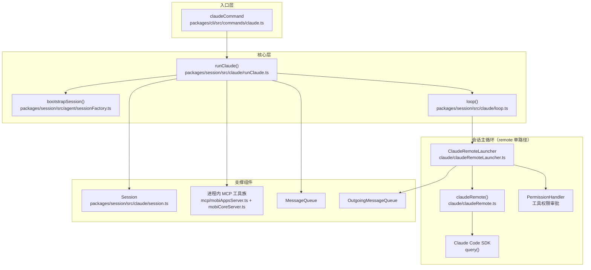
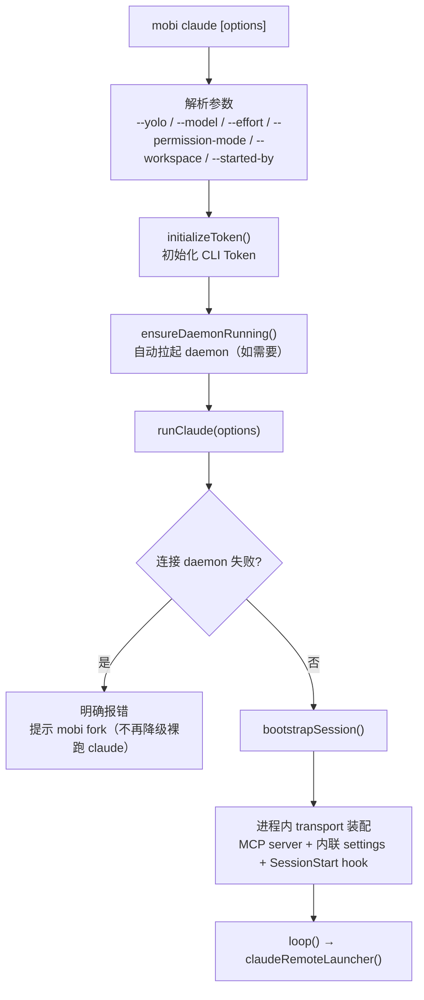
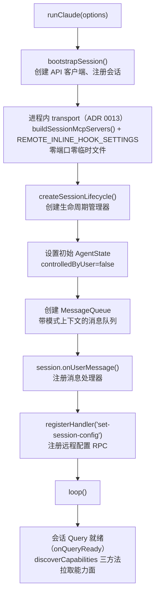
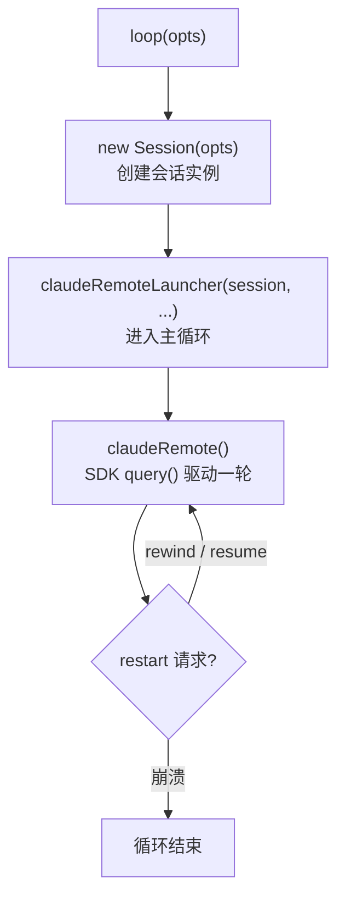
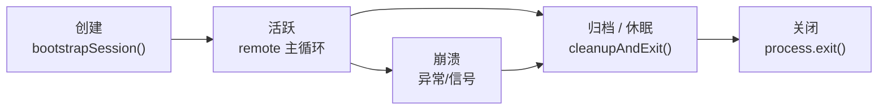
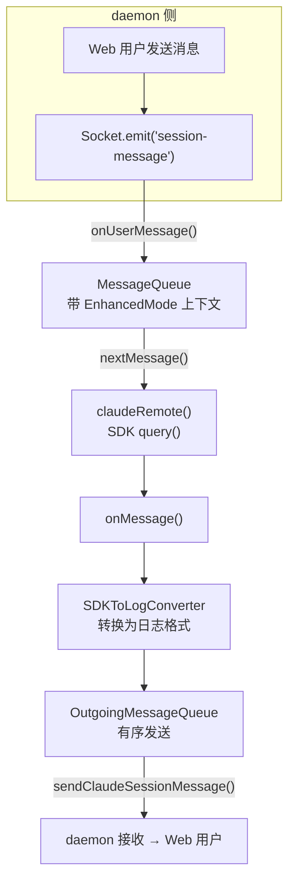
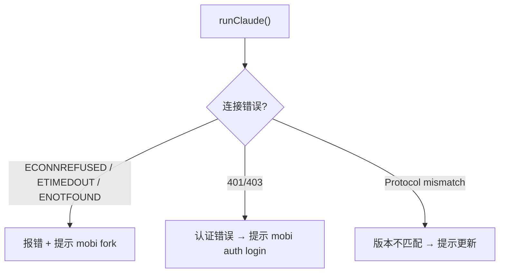

# Claude 命令 — 会话宿主与启动链路

`mobi claude …` 是 daemon spawn 会话进程的内部入口（不出现在用户帮助里）；用户面的 `mobi` 无参只打印帮助。会话宿主只有 **remote 一条驱动路径**：Claude Agent SDK 在 mobi 进程内驱动 Claude，消息经 daemon 中转，Web 远程控制。

终端侧的兜底接续走 `mobi fork`（把 Web 会话上下文 fork 成独立的原生 Claude TUI 会话），详见 [ADR 0013](../../../../adr/0013-tui-continuation-via-fork.md)。

**入口文件**: [`packages/cli/src/commands/claude.ts`](/packages/cli/src/commands/claude.ts)

---

## 新人阅读指引

### 建议阅读顺序

```
第 1 步: 本文档（README.md）           ← 你在这里，建立全局认知
    │
第 2 步: remote-mode.md               ← 理解会话如何通过 SDK 进程内驱动
    │
第 3 步: 按需阅读
    ├── message-queue.md              ← 入站消息队列：分批收集用户消息
    ├── outgoing-message-queue.md     ← 出站消息队列：有序发送 Claude 输出到 daemon
    ├── session-scanner.md            ← transcript 增量扫描（观测/唤醒/rewind 判据）
    ├── api/ 通信层文档                ← 与 daemon 的通信机制
    └── mcp/ 工具族文档                ← 进程内 MCP server 装配
```

### 前置知识

| 前置内容 | 位置 | 为什么需要 |
|----------|------|-----------|
| daemon 架构 | [daemon 架构](../../../daemon/) | 会话宿主通过 daemon 实现远程控制 |
| API 通信层 | [docs/architecture/cli/api/](../../api/) | Session 通过 Socket.IO 与 daemon 通信 |
| MCP 工具族 | [docs/architecture/cli/mcp/](../../mcp/) | 会话内 MCP 工具（进程内 SDK server） |

### 术语表

| 术语 | 含义 |
|------|------|
| **Remote 模式** | 通过 Claude Code SDK 驱动 Claude，消息经由 daemon 中转，支持远程控制。**当前唯一模式** |
| **Session** | mobi 会话宿主进程内的状态对象；一次 daemon 会话对应一个宿主进程 |
| **Claude Session ID** | Claude Code 的原生会话标识（UUID），用于 `--resume` / fork 锚点 |
| **daemon Session** | daemon 侧的会话记录，一个 daemon Session 可对应多个 Claude Session（如 /clear 后） |
| **Launcher** | 启动器，封装主循环、abort RPC 与清理（当前只有 remote） |
| **TUI 接续** | `mobi fork`：只读 daemon SQLite 选出会话，以 `claude --resume <nativeId> --fork-session` 在终端开独立分支 |
| **PermissionHandler** | 工具权限审批处理器 |
| **SessionScanner** | 监听 Claude transcript JSONL 的扫描器（观测、唤醒与 rewind 判据） |
| **OutgoingMessageQueue** | 有序发送消息到 daemon 的队列 |
| **MessageQueue** | 带模式上下文的消息队列，管理用户消息与排队取消，支持 localId 追踪 |
| **KeepAlive** | 定时心跳（2 秒），向 daemon 报告会话状态 |
| **controlledByUser** | AgentState 历史字段。local 退场后恒为 `false`，仅历史会话读侧兼容 |

---

## 架构概览



## 启动流程

`mobi claude …`（daemon spawn）的完整启动链路：



### 阶段一：入口初始化（`claude.ts`）

**文件**: `packages/cli/src/commands/claude.ts`

1. **参数解析** — 提取 mobi 特有参数（`--yolo`、`--model`、`--effort`、`--permission-mode`、`--fast-mode`、`--output-style`、`--workspace`、`--started-by`），其余透传给 Claude
2. **提前返回** — 无参数或 `--help` 时只打印 `DEFAULT_HELP_TEXT`（帮助里没有 `mobi claude`，它不是终端用户入口）
3. **Token 初始化** — `initializeToken()` 确保 CLI_API_TOKEN 可用
4. **daemon 自动拉起** — `ensureDaemonRunning()` 检查 daemon 是否运行，必要时后台启动
5. **错误路径** — 连接失败直接报错并提示 `mobi fork`；协议版本不匹配时给出升级提示

**参数说明**：

| 参数 | 说明 |
|------|------|
| `--yolo` | 透传为 `--dangerously-skip-permissions`，跳过权限确认 |
| `--model <model>` | 指定 Claude 模型 |
| `--effort <level>` | 指定 reasoning effort |
| `--permission-mode <mode>` | 指定初始权限模式 |
| `--fast-mode <true\|false>` | 快速模式预设（mobi 自有 flag，经 `applyFlagSettings` 注入） |
| `--output-style <style>` | CC output style（mobi 自有 flag，经 `applyFlagSettings` 注入） |
| `--started-by <source>` | 启动来源：`daemon`（宿主 spawn） |
| `--workspace <id>` | 归属工作区 id（Web spawn 透传） |
| 其他参数 | 透传给 Claude Code |

参数解析由 `commands/claudeArgs.ts` 的 `parseStartOptions()` 纯函数完成（mobi 自身 flag 进 options，其余透传 claudeArgs）。

### 阶段二：会话启动（`runClaude.ts`）

**文件**: `packages/session/src/claude/runClaude.ts`



核心组件初始化：

| 组件 | 文件 | 职责 |
|------|------|------|
| **ApiClient** | `packages/node-core/src/api/api.ts` | HTTP 客户端，与 daemon REST API 通信 |
| **ApiSessionClient** | `packages/session/src/api/apiSession.ts` | Socket.IO 客户端，实时通信 |
| **Session** | `packages/session/src/claude/session.ts` | 会话状态管理（ID、model、权限模式等） |
| **MCP 工具族** | `packages/session/src/mcp/mobiAppsServer.ts` + `mobiCoreServer.ts` | 进程内 SDK server（mobi-apps / mobi-core） |
| **SessionStart Hook** | `claudeRemote` 的 SDK 进程内回调 | 捕获 native session id 变化，绑定守卫见 `claude/utils/sessionIdBinding.ts` |
| **MessageQueue** | `packages/node-core/src/utils/MessageQueue.ts` | 带模式上下文的消息队列 |
| **SessionLifecycle** | `packages/session/src/agent/sessionLifecycle.ts` | 进程信号处理和清理 |

### 阶段三：会话主循环（`loop.ts` → `claudeRemoteLauncher`）

**文件**: `packages/session/src/claude/loop.ts` → `packages/session/src/claude/claudeRemoteLauncher.ts`



local 退场后不再有双模循环与模式切换：主循环在进程生命周期内持续消费用户消息，重启由 rewind / query restart 状态机驱动，直到进程被 daemon 终结或崩溃。

## 会话生命周期



### 创建（bootstrapSession）

**文件**: `packages/session/src/agent/sessionFactory.ts`

```
bootstrapSession({ flavor, startedBy, workingDirectory, workspaceId, ... })
    │
    ├── ApiClient.create()                    ← HTTP 客户端
    ├── buildSessionMetadata(workingDir, ...) ← 构建会话元数据
    ├── api.getOrCreateSession(...)           ← 创建/获取会话（新会话 mode 恒为 remote）
    ├── resolveAdditionalDirectories(workspace) ← 从 workspace.folders 派生附加目录并冻结进 metadata
    ├── api.sessionSyncClient(sessionInfo)    ← Socket.IO 客户端
    └── notifyRunnerSessionStarted()          ← 会话自报宿主通道
```

### 关闭（cleanupAndExit）

**文件**: `packages/session/src/agent/sessionLifecycle.ts`

关闭顺序：

```
cleanupAndExit()
    │
    ├── session.stopKeepAlive()         ← 停止心跳
    ├── onBeforeClose()                 ← 终止 SDK Query / 进程树
    ├── session.close()                 ← 关闭 Socket.IO 连接
    ├── onAfterClose()                  ← 停止 bridge tap 订阅与监听
    └── process.exit(exitCode)          ← 退出进程
```

**退出码**：
- `0` — 正常退出（归档 / 休眠 / 终结）
- `1` — 异常退出（崩溃）

**信号处理**：注册 SIGTERM、SIGINT、uncaughtException、unhandledRejection 处理器，均触发 `cleanupAndExit()`。

## 与 daemon 的交互

### Socket.IO 事件

Session 通过 `ApiSessionClient` 与 daemon 保持双向实时通信：

| 事件 | 方向 | 说明 |
|------|------|------|
| `message` | CLI → daemon | 发送用户消息 / Agent 输出 |
| `session-alive` | CLI → daemon | 心跳（2 秒），报告 thinking 状态（`mode` 为 deprecated 字段） |
| `update-metadata` | CLI → daemon | 更新会话元数据（版本化，乐观锁） |
| `update-state` | CLI → daemon | 更新 AgentState（版本化，乐观锁） |
| `session-end` | CLI → daemon | 通知会话结束 |
| `messages-facts` | CLI → daemon | 统一消息事实事件：pushed / bound / attached / acked / lifecycle 五 kind 批内合并 |
| `cancel-queued-message` | daemon → CLI | RPC：取消 CLI 内存队列中缓冲的排队消息 |
| `update` | daemon → CLI | 接收状态更新（消息、session） |
| `rpc-request` | daemon → CLI | RPC 请求（abort、set-session-config 等） |
| `terminal:*` | 双向 | 终端事件（open/write/resize/close） |

### 状态同步机制

CLI 与 daemon 的状态同步采用**版本化乐观锁**：

```
CLI: metadataVersion = 5
    │
    ├── updateMetadata(draft => { ...draft, status: 'active' })
    │   └── socket.emit('update-metadata', { version: 5, metadata: ... })
    │
    ├── daemon 成功: version 6 → CLI 更新本地 version = 6
    │
    └── daemon 失败（version-mismatch）: CLI 重试，重新获取最新版本再更新
```

### RPC 系统

daemon 可通过 RPC 远程控制 CLI 会话：

| RPC 方法 | 说明 |
|----------|------|
| `abort` | 中止当前操作（三档 stopKind） |
| `set-session-config` | 远程修改 permissionMode / model / effort 等 |
| `cancel-queued-message` | 取消 CLI 内存队列中缓冲的排队消息 |
| Common RPC（bash、files、git 等） | 供 daemon 远程执行本地操作 |

模式切换 RPC（`switch`）已随 local 模式删除（协议版本 2，tui-fork 票 07）。

## 消息处理流程



## 代码结构

会话宿主体现在 `@mobi/session` 包；ApiClient 与 RPC 处理器在 `@mobi/node-core`。

```
packages/cli/src/
├── commands/
│   ├── claude.ts                         # 内部入口（daemon spawn），参数解析与错误处理
│   ├── claudeArgs.ts                     # 参数解析纯函数 parseStartOptions()
│   ├── fork.ts                           # 终端接续：只读 SQLite 选会话 → claude --fork-session
│   ├── forkPlan.ts                       # 选中解析纯逻辑（短 id / 标题 / 消歧）
│   ├── sessions.ts                       # sessions list 读只读 SQLite
│   └── defaultHelp.ts                    # mobi 无参帮助
└── ...

packages/session/src/
├── claude/
│   ├── runClaude.ts                      # 核心启动流程，组件编排
│   ├── loop.ts                           # 会话主循环入口（remote 单路径）
│   ├── session.ts                        # Session 类（扩展 AgentSessionBase）
│   ├── claudeRemoteLauncher.ts           # 启动器（类）：主循环 + abort RPC + 清理
│   ├── claudeRemote.ts                   # SDK query() 驱动
│   ├── model.ts                          # 模型名称规范化
│   ├── registerKillSessionHandler.ts     # 注册 kill-session RPC
│   ├── types.ts                          # 类型定义
│   ├── bridge/                           # CLI↔session 事件桥（goal / wakeup / forked skill tap）
│   └── utils/
│       ├── capabilityDiscovery.ts        # 会话 Query 三方法能力面发现
│       ├── permissionHandler.ts          # 工具权限审批处理器
│       ├── sessionScanner.ts             # transcript 增量扫描（观测/唤醒/rewind 判据）
│       ├── OutgoingMessageQueue.ts       # 有序消息发送队列
│       ├── sessionIdBinding.ts           # sessionId 绑定幂等守卫
│       ├── sdkToLogConverter.ts          # SDK 消息 → 日志格式转换
│       └── ...
├── agent/
│   ├── sessionBase.ts                    # AgentSessionBase 基类
│   ├── sessionFactory.ts                 # 会话工厂（bootstrap）
│   └── sessionLifecycle.ts               # 生命周期管理
├── modules/common/remote/RemoteLauncherBase.ts  # 启动器基类
└── api/
    ├── apiSession.ts                     # ApiSessionClient（Socket.IO）
    ├── sessionChannel.ts                 # 会话通道（消息落库/广播的会话侧入口）
    └── sessionTransport.ts               # 传输层装配
```

## 环境变量

| 变量 | 默认值 | 说明 |
|------|--------|------|
| `DISABLE_AUTOUPDATER` | `1` | 禁用 Claude 自动更新 |
| `DEBUG` | — | 开启时输出详细错误堆栈 |
| `MOBI_API_URL` | — | 指定 daemon 地址（跳过自动启动） |

## 错误处理

### 连接错误



local 模式退场后不再有「连接失败降级裸跑 claude」的逃生舱：会话必须由 daemon 驱动，终端接续请用 `mobi fork`。

### 协议版本检查

错误响应头 `X-Mobi-Protocol-Version` 携带 daemon 的 `PROTOCOL_VERSION`，与 CLI 侧对比：
- daemon 版本落后 → 提示更新 daemon
- CLI 版本落后 → 提示更新 CLI
